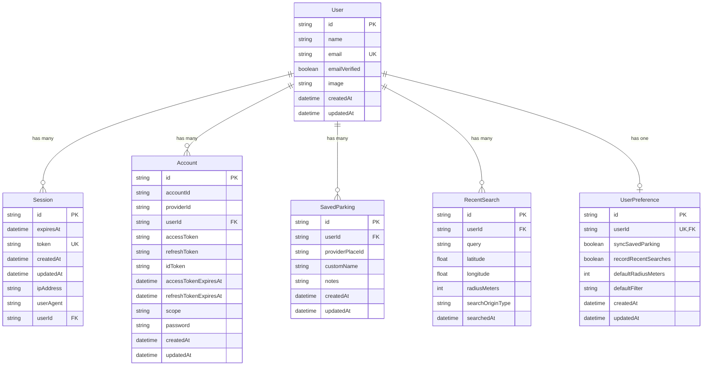

# Prakaro Database & Persistence Architecture — MySQL & Prisma

## 1. Overview
Prakaro uses **MySQL 8+** as its primary relational store and **Prisma ORM** as the type-safe data access layer. The database schema accommodates two distinct domain groups:
1. **Better Auth Authentication Tables**: Stores user identities, sessions, credential accounts, and email verification tokens.
2. **Prakaro Application Tables**: Stores cloud-synced parking bookmarks, user recent searches, and privacy/sync preferences.

---

## 2. Strict Google Places Compliance Rule

> [!IMPORTANT]
> **NO GOOGLE PLACES CONTENT MAY BE STORED IN THE DATABASE.**
> Per Google Places API Terms of Service, external place names, addresses, ratings, geometry coordinates, photos, and operational metadata MUST NOT be persisted in any database. Only the **Google Place ID** (`providerPlaceId`) and user-generated metadata (such as custom labels, notes, or opt-in timestamps) may be stored.
> When the mobile app needs full facility details for a saved bookmark, it resolves them on-demand via the backend API.

---

## 3. Prisma Schema Entity-Relationship

---

## 4. Table Specifications & Indexes

### `users`
- Primary key: `id` (VARCHAR 191)
- Unique: `email`
- Created/Updated timestamps.

### `sessions`
- Primary key: `id` (VARCHAR 191)
- Unique: `token`
- Foreign Key: `userId` -> `users(id)` ON DELETE CASCADE.
- Index: `[userId]`

### `accounts`
- Primary key: `id` (VARCHAR 191)
- Foreign Key: `userId` -> `users(id)` ON DELETE CASCADE.
- Index: `[userId]`

### `saved_parkings`
- Primary key: `id` (VARCHAR 191, CUID or UUID)
- Columns:
  - `userId`: Foreign key to `users(id)` ON DELETE CASCADE.
  - `providerPlaceId`: Google Place ID (VARCHAR 255).
  - `customName`: User-assigned optional nickname (VARCHAR 191, nullable).
  - `notes`: User-assigned optional notes (TEXT, nullable).
- Unique compound constraint: `@@unique([userId, providerPlaceId])` ensures a user cannot duplicate a saved place.
- Indexes: `[userId]`, `[providerPlaceId]`

### `recent_searches`
- Primary key: `id` (VARCHAR 191)
- Columns:
  - `userId`: Foreign key to `users(id)` ON DELETE CASCADE.
  - `query`: Text description or destination name (VARCHAR 255).
  - `latitude`: Search center latitude (DOUBLE).
  - `longitude`: Search center longitude (DOUBLE).
  - `radiusMeters`: Search radius in meters (INT).
  - `searchOriginType`: Origin type (`currentLocation`, `selectedMapArea`, `destination`).
  - `searchedAt`: Timestamp (DATETIME(3)).
- Indexes: `[userId, searchedAt]` for efficient chronological sorting and bounds limiting (maximum 10 searches per user).

### `user_preferences`
- Primary key: `id` (VARCHAR 191)
- Columns:
  - `userId`: Unique foreign key to `users(id)` ON DELETE CASCADE.
  - `syncSavedParking`: Default `true`.
  - `recordRecentSearches`: Default `false` (**Privacy-first opt-in**).
  - `defaultRadiusMeters`: Default `3000`.
  - `defaultFilter`: Default `all`.

---

## 5. Privacy & Data Lifecycle Controls

1. **Privacy-First Search Recording**:
   - `recordRecentSearches` defaults to `false`. Search queries are NOT written to the database unless the user has explicitly opted in via Profile or Settings.
2. **Cascading Deletions**:
   - Deleting a user via `DELETE /api/v1/users/me` immediately cascades across `sessions`, `accounts`, `saved_parkings`, `recent_searches`, and `user_preferences`.
   - Zero orphaned records remain in the database.
3. **Database Maintenance & Migrations**:
   - Schema defined in `apps/api/prisma/schema.prisma`.
   - Applied in development using `npx prisma db push` or `npx prisma migrate dev`.
