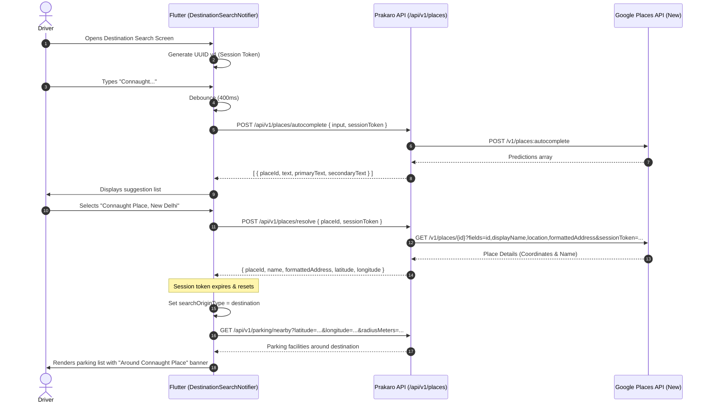

# Prakaro Destination Search & Google Places Proxy Architecture

## 1. Overview
Prakaro provides a destination-based parking discovery workflow that allows drivers to search for parking around a future destination (e.g., an airport, stadium, commercial district, or train station) before starting their journey.

In accordance with strict security requirements:
- Flutter mobile apps **never call Google Places API directly**.
- All autocomplete suggestions and place detail resolutions are proxied through the Prakaro Fastify backend (`apps/api`).
- Google Places API session tokens are strictly managed to optimize API billing.

---

## 2. Request Lifecycle & Session Token Architecture



---

## 3. Google Places API Cost Optimization

1. **Session Tokens**:
   - Google Places charges Autocomplete queries per session rather than per keystroke when grouped with a subsequent Place Details query using the same session token.
   - Flutter generates a fresh UUID v4 token upon opening the search screen or after completing a search.
   - The session token is passed through to `POST /api/v1/places/autocomplete` and concluded on `POST /api/v1/places/resolve`.
2. **Debounce (400ms)**:
   - Keystrokes in the mobile search input are debounced by 400ms to eliminate intermediate queries while the user is actively typing.
3. **Field Mask Filtering**:
   - Place Details resolution requests only the minimal necessary fields:
     `id,displayName,location,formattedAddress`.
   - No unnecessary photo metadata, contact info, or high-tier SKU fields are requested.

---

## 4. Search Origin Types

Prakaro supports three explicit search origin modes tracked in Riverpod (`SearchOriginType`):

| Origin Type | Trigger | Screen Title / Context Banner | Behavior on Refresh |
|---|---|---|---|
| `currentLocation` | Default app launch or "Near me" tap | "Near you" / Current coordinates | Re-queries device GPS location |
| `selectedMapArea` | User pans/zooms map & taps "Search this area" | "Selected map area" | Searches map camera center coordinates |
| `destination` | User searches & selects a destination | "Around <Destination Name>" | Searches resolved destination coordinates with reset button to return to GPS |

---

## 5. Endpoints Specification

### `POST /api/v1/places/autocomplete`
- **Request Body**:
  ```json
  {
    "input": "Connaught Place",
    "sessionToken": "4bbd0541-69cb-4c57-897c-9b5cfb5fbc35",
    "latitude": 28.6139,
    "longitude": 77.2090,
    "radiusMeters": 50000
  }
  ```
- **Response**:
  ```json
  {
    "data": [
      {
        "placeId": "ChIJb_28z_rkDDkR7Lh4jZ0Z_a0",
        "text": "Connaught Place, New Delhi, Delhi, India",
        "primaryText": "Connaught Place",
        "secondaryText": "New Delhi, Delhi, India"
      }
    ],
    "meta": {
      "count": 1,
      "sessionActive": true
    }
  }
  ```

### `POST /api/v1/places/resolve`
- **Request Body**:
  ```json
  {
    "placeId": "ChIJb_28z_rkDDkR7Lh4jZ0Z_a0",
    "sessionToken": "4bbd0541-69cb-4c57-897c-9b5cfb5fbc35"
  }
  ```
- **Response**:
  ```json
  {
    "data": {
      "placeId": "ChIJb_28z_rkDDkR7Lh4jZ0Z_a0",
      "name": "Connaught Place",
      "formattedAddress": "Connaught Place, New Delhi, Delhi 110001, India",
      "latitude": 28.6315,
      "longitude": 77.2167
    },
    "meta": {
      "sessionConcluded": true
    }
  }
  ```
