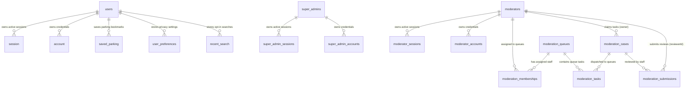

# Prakaro — Identity & Authentication Architecture Specification
**Document Version:** 2.0.0 (Milestone 13.1 Refactor)  
**Classification:** Enterprise Platform Security & Data Integrity  
**Target Systems:** Fastify Backend, MySQL 8.0+, Prisma ORM, Better Auth, React.js Console, Flutter Mobile  

---

## 1. Executive Summary & Architectural Motivation

In Milestone 13, administrative staff and ordinary mobile drivers shared the base `user` table through a role flag or auxiliary table. While functional for rapid prototyping, this unified user table introduced severe architectural vulnerabilities:
1. **Cross-Domain Session Forgery Risk**: Session tokens issued to ordinary drivers could potentially probe internal moderation endpoints.
2. **Privilege Escalation Exposure**: Any flaw in user self-registration could grant an attacker an administrative footprint.
3. **Database Integrity & Foreign Key Ambiguity**: Cases, queue permissions, and audit logs could not reliably enforce administrative integrity at the foreign key constraint level without referencing ordinary application users.

**Milestone 13.1 completely refactors the identity architecture into three logically and physically separate identity sets:**
1. **`users` (`User`)**: Exclusively ordinary mobile application users (parking discovery, saves, preferences, problem reporting). Public self-registration via mobile app.
2. **`super_admins` (`SuperAdmin`)**: Platform-level infrastructure administrators (AI provider settings, platform config, moderator management, platform audits). Zero public registration; secure out-of-band provisioning.
3. **`moderators` (`Moderator`)**: Content moderation staff and operational administrators (`MODERATION_ADMIN`, `MODERATION_MANAGER`, `SUPERVISOR`, `QA_REVIEWER`, `MODERATOR`, `VIEWER`). Provisioned only by authorized administrators.

---

## 2. Database Schema & Entity-Relationship Architecture



### 2.1 Table Definitions & Models

#### A. Mobile Application Users (`users`)
- **Table Name**: `users` (mapped via `@@map("users")`)
- **Prisma Model**: `User`
- **Fields**:
  - `id`: `String @id @default(uuid())`
  - `name`: `String`
  - `email`: `String @unique`
  - `emailVerified`: `Boolean @default(false)`
  - `image`: `String?`
  - `status`: `String @default("ACTIVE") @db.VarChar(32)`
  - `createdAt`: `DateTime @default(now())`
  - `updatedAt`: `DateTime @updatedAt`
- **Associated Better Auth Models**:
  - `Session` (`sessions`)
  - `Account` (`accounts`)
  - `Verification` (`verifications`)
- **Application Relationships**:
  - `savedParking`: `SavedParking[]`
  - `preferences`: `UserPreferences?`
  - `recentSearches`: `RecentSearch[]`

#### B. Platform Super Administrators (`super_admins`)
- **Table Name**: `super_admins` (mapped via `@@map("super_admins")`)
- **Prisma Model**: `SuperAdmin`
- **Fields**:
  - `id`: `String @id @default(uuid())`
  - `name`: `String`
  - `email`: `String @unique`
  - `emailVerified`: `Boolean @default(true)`
  - `image`: `String?`
  - `status`: `String @default("ACTIVE") @db.VarChar(32)`
  - `lastLoginAt`: `DateTime?`
  - `createdBySuperAdminId`: `String?`
  - `createdAt`: `DateTime @default(now())`
  - `updatedAt`: `DateTime @updatedAt`
- **Associated Better Auth Models**:
  - `SuperAdminSession` (`super_admin_sessions`)
  - `SuperAdminAccount` (`super_admin_accounts`)
  - `SuperAdminVerification` (`super_admin_verifications`)
- **Guarantees**:
  - No foreign keys linking ordinary user activities.
  - Zero public registration.
  - Provable attribution for who provisioned each administrator.

#### C. Trust & Safety Moderation Staff (`moderators`)
- **Table Name**: `moderators` (mapped via `@@map("moderators")`)
- **Prisma Model**: `Moderator`
- **Fields**:
  - `id`: `String @id @default(uuid())`
  - `name`: `String`
  - `email`: `String @unique`
  - `emailVerified`: `Boolean @default(true)`
  - `image`: `String?`
  - `role`: `String @default("MODERATOR") @db.VarChar(40)` (`MODERATION_ADMIN`, `MODERATION_MANAGER`, `SUPERVISOR`, `QA_REVIEWER`, `MODERATOR`, `VIEWER`)
  - `status`: `String @default("ACTIVE") @db.VarChar(32)` (`ACTIVE`, `DEACTIVATED`, `SUSPENDED`)
  - `invitedBy`: `String?`
  - `activatedBy`: `String?`
  - `deactivatedAt`: `DateTime?`
  - `lastLoginAt`: `DateTime?`
  - `createdAt`: `DateTime @default(now())`
  - `updatedAt`: `DateTime @updatedAt`
- **Associated Better Auth Models**:
  - `ModeratorSession` (`moderator_sessions`)
  - `ModeratorAccount` (`moderator_accounts`)
  - `ModeratorVerification` (`moderator_verifications`)
- **Operational Foreign Key Relationships**:
  - `memberships`: `ModerationMembership[]` (onDelete: Cascade)
  - `cases`: `ModerationCase[]` (relation: `owner`, references `moderators.id`)
  - `submissions`: `ModerationSubmission[]` (relation: `reviewerId`, references `moderators.id`)

---

## 3. Better Auth Multi-Instance Isolation

To guarantee that sessions cannot cross domain boundaries, the Fastify backend configures **three discrete Better Auth instances** in `apps/api/src/config/auth.ts`:

```typescript
// 1. Mobile Driver Authentication Instance
export const auth = betterAuth({
  database: prismaAdapter(prisma, { provider: 'mysql' }),
  basePath: '/api/auth',
  user: { modelName: 'user' },
  session: {
    modelName: 'session',
    cookieCache: { enabled: false },
    cookieName: 'prakaro_user.session_token',
  },
  account: { modelName: 'account' },
  verification: { modelName: 'verification' },
  plugins: [bearer()],
});

// 2. Moderator & Trust-and-Safety Staff Instance
export const moderatorAuth = betterAuth({
  database: prismaAdapter(prisma, { provider: 'mysql' }),
  basePath: '/api/moderator-auth',
  user: { modelName: 'moderator' },
  session: {
    modelName: 'moderatorSession',
    cookieCache: { enabled: false },
    cookieName: 'prakaro_moderator.session_token',
  },
  account: { modelName: 'moderatorAccount' },
  verification: { modelName: 'moderatorVerification' },
  emailAndPassword: {
    enabled: true,
    disableSignUp: true, // Prevents public self-registration
  },
  plugins: [bearer()],
});

// 3. Platform Super Administrator Instance
export const superAdminAuth = betterAuth({
  database: prismaAdapter(prisma, { provider: 'mysql' }),
  basePath: '/api/super-admin-auth',
  user: { modelName: 'superAdmin' },
  session: {
    modelName: 'superAdminSession',
    cookieCache: { enabled: false },
    cookieName: 'prakaro_super_admin.session_token',
  },
  account: { modelName: 'superAdminAccount' },
  verification: { modelName: 'superAdminVerification' },
  emailAndPassword: {
    enabled: true,
    disableSignUp: true, // Zero public self-registration
  },
  plugins: [bearer()],
});
```

### 3.1 Endpoint Routing Isolation in Fastify

The three auth handlers are mounted on dedicated prefixes in `apps/api/src/app.ts`:
- `/api/auth/*` -> Handled exclusively by `auth`
- `/api/moderator-auth/*` -> Handled exclusively by `moderatorAuth`
- `/api/super-admin-auth/*` -> Handled exclusively by `superAdminAuth`

### 3.2 Security Matrix & Cross-Domain Protections

| Attempted Action | Auth Domain Tested | Result | Security Mechanism |
| :--- | :--- | :--- | :--- |
| Mobile driver calls `/api/v1/moderation/queues` | `auth` token | **403 Forbidden** | `staff(req)` session resolver strictly verifies against `superAdminAuth` and `moderatorAuth` |
| Driver attempts sign-in at `/api/moderator-auth/sign-in/email` | `moderatorAuth` | **401 Unauthorized** | `moderatorAuth` queries `moderators` table; user is not in `moderators` |
| Moderator calls `/api/v1/moderation/super-admins` | `moderatorAuth` token | **403 Forbidden** | `a.superAdmin === true` guard rejects all non-super admins |
| Deactivated moderator makes any API call | `moderatorAuth` token | **403 Forbidden** | `staff(req)` queries DB status and rejects inactive accounts on every request |
| Mobile driver submits parking issue report | `auth` token | **200 OK** | Report endpoint specifically resolves mobile `userSession(req)` |
