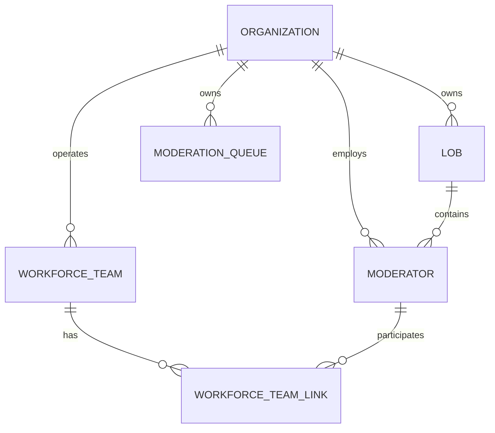

# Workforce architecture

Fastify resolves a staff session from the existing Super Admin and Moderator Better Auth instances. The workforce plugin scopes queries before executing them. The public Flutter API keeps its separate identity domain.

A staff member holds one LOB. Team links can span several LOBs in the same organization. Their assignment kind distinguishes ordinary members, managers and supervisors. Workforce writes use the existing moderation audit table and retain the actor identity domain.

The API serves `/api/v1/organizations`, `/api/v1/lobs`, `/api/v1/workforce/staff`, `/api/v1/workforce/teams` and `/api/v1/workforce/dashboard`. Directory reads accept `page`, `search`, `status` and `sort`, with 25 results per page. Record reads use stable UUIDs. LOB assignment uses POST to `/lobs/:id/assign-organization`. Team assignments use POST to `/workforce/teams/:id/members` and DELETE to `/workforce/teams/:id/members/:staffId`.

