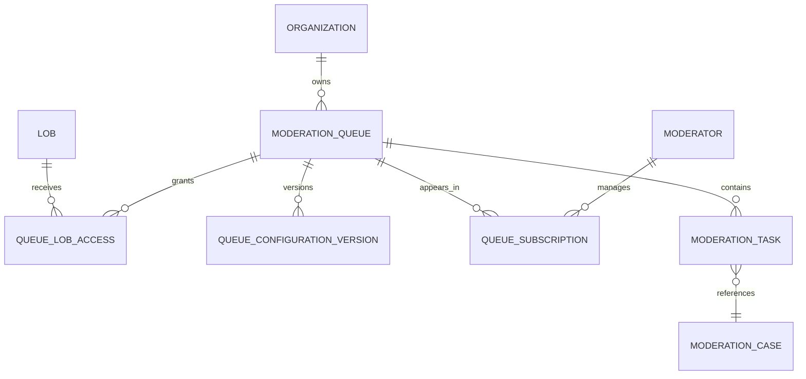

# Phase 2 queue architecture

Fastify loads organizational membership from the existing Better Auth identity domains. Queue authorization uses current LOB grants and queue status. Organization Directors can configure queues in their organization when their delegation is active. Managers and supervisors require an active leadership team assignment and an authorized LOB. Existing per-person grants remain historical records and grant no access.

| Route | Surface |
| --- | --- |
| /queues | Queue directory |
| /queues/new, /queues/:id/settings | Ownership, eligibility, LOBs, policy, form, capacity and version history |
| /available-queues, /my-queues | Moderator discovery and personal worklist |
| /queues/:id | Workload and activity |
| /queues/:id/cases, /queues/:id/cases/:caseId | Queue case list and read-only evidence |
| /queues/:id/moderate | Prerequisites for future operational moderation |

The Phase 1 shell keeps the six-state AUX control in its top-right header. It still shows Unavailable because attendance persistence belongs to Phase 3. The historical mutation entry points reject attempts to claim, release, update evidence, submit or publish from legacy clients. Queue sources and scope remain available to operational QA and escalation indexes.

The queue APIs live below `/api/v1/moderation`. GET and PUT `/queues/:id/lobs` read or replace current LOB grants. GET `/queues/:id/versions` reads immutable snapshots. Queue-scoped case endpoints accept filters and paginate by 25. `/queues/:id/metrics` and `/queues/:id/activity` have independent contracts.

