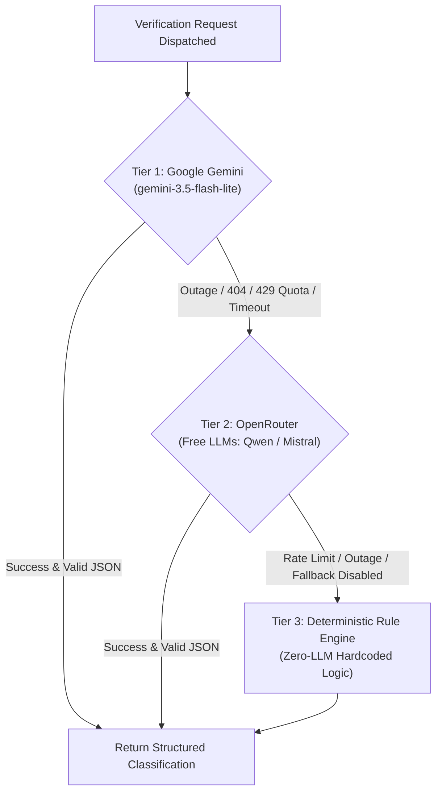

# Prakaro — AI Advisory Verification & Multi-Tier Provider Resilience
**Document Version:** 1.0.0 (Milestone 13.1 AI Architecture)  
**Classification:** Machine Learning & LLM Integration Specification  
**Target Modules:** `apps/api/src/modules/intelligence/`  

---

## 1. Advisory Philosophy & Role of AI

In Prakaro's Trust & Safety architecture, **AI never acts as an unmonitored decision maker**. AI classifications are treated strictly as **advisory triage signals** designed to:
1. Pre-evaluate evidence sufficiency for human reviewers.
2. Route high-confidence cases to expedited queues.
3. Flag high-risk ambiguity for senior supervisor review.
4. Accelerate human verification without ever publishing unreviewed assertions directly to drivers.

---

## 2. Multi-Tier Provider Fallback Architecture



### Tier 1: Primary Provider — Google Gemini
- **Model**: `gemini-3.5-flash-lite` (with automatic fallback to `gemini-1.5-flash` or `gemini-1.5-pro` based on environment).
- **Protocol**: Google GenAI SDK (`@google/genai`) and Google AI Studio REST v1beta endpoints.
- **Output Mode**: Strict JSON Schema enforcement via `responseSchema`.
- **Status in Live Test**: Verified functional with live generation and sub-second latency.

### Tier 2: Secondary Provider — OpenRouter Free
- **Model**: `qwen/qwen-2.5-7b-instruct:free` or `mistralai/mistral-7b-instruct:free`.
- **Protocol**: OpenAI-compatible REST API.
- **Paid Model Protection**: Enforced by `AI_ALLOW_PAID_MODELS=false`. Rejects paid endpoints to prevent unexpected billing.
- **Trigger Conditions**: HTTP 404 (model not found), HTTP 429 (quota exhausted), network timeout (>8000ms), or malformed output.

### Tier 3: Deterministic Rule Engine
- **Engine**: Pure TypeScript rule evaluator (`apps/api/src/modules/intelligence/intelligence.rules.ts`).
- **Guarantee**: Even if all external LLM gateways are down or disconnected, the system reliably evaluates physical evidence according to hardcoded mobility safety heuristics:
  - Minimum of 2 corroborating evidence sources required for positive verification.
  - Zero unverified facilities published without confirmed access markers.

---

## 3. Strict Output Validation & Schema Defense

Every LLM response is rigorously parsed against `aiOutputSchema` (`apps/api/src/modules/intelligence/intelligence.schemas.ts`):

```typescript
export const aiOutputSchema = z
  .object({
    classification: z.enum([
      'VERIFIED_PARKING',
      'VERIFIED_NON_PARKING',
      'UNVERIFIED_INSUFFICIENT_EVIDENCE',
      'CONTRADICTORY_EVIDENCE',
    ]),
    confidence: z.number().min(0).max(1),
    supportedEvidenceIds: z.array(z.string()).max(12),
    reason: z.enum([
      'STRONG_OFFICIAL_RECORD',
      'DIRECT_PHYSICAL_ACCESS_CONFIRMED',
      'OPERATOR_GROUND_TRUTH',
      'NON_PARKING_VENUE_CONFIRMED',
      'EVIDENCE_EXPIRED',
      'CONFLICTING_RECORDS',
      'INSUFFICIENT_DATA',
    ]),
    missingEvidence: z.array(missingItem).max(4),
    needsHumanReview: z.boolean(),
  })
  .strict();
```

### Safety Rules:
- If the model emits extra keys, `.strict()` fails validation.
- If the model references non-existent evidence IDs, cross-reference validation fails.
- In any validation failure, the request falls back cleanly to the deterministic rule engine without throwing uncaught exceptions or leaking keys.

---

## 4. Quota Exhaustion & Budget Controls

1. **Daily Call Budget**: Tracked per calendar day in `parking_ai_daily_budget`.
2. **Hard Cap**: Monitored against `AI_MAX_CALLS_PER_DAY` (default: 50 calls/day).
3. **Graceful Degradation**: Once the daily budget is met, AI triage automatically disengages, and all incoming cases are routed cleanly into standard human review queues without dropping search discovery.
