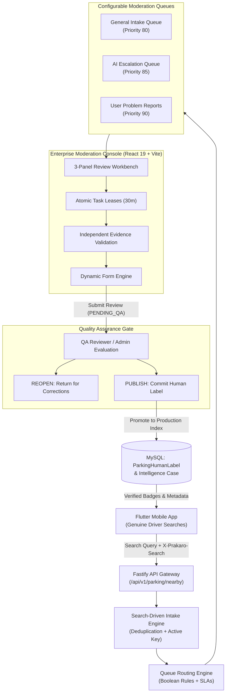

# Prakaro — Parking Verification & Enterprise Moderation Architecture

## 1. Architectural Overview

Prakaro's verification platform is an enterprise-grade trust-and-safety and human-in-the-loop (HITL) moderation system designed to deliver high-confidence parking discovery for drivers. It bridges automated candidate discovery (via Google Places API), multi-provider AI triage (Google Gemini and OpenRouter fallback), and multi-tier human moderation with rigorous Quality Assurance (QA).



---

## 2. Monorepo Structural Organization

```
prakaro/
├── apps/
│   ├── api/                  # Fastify + TypeScript + Prisma Backend
│   │   ├── prisma/           # Prisma MySQL Schema & Migrations
│   │   ├── src/
│   │   │   ├── modules/
│   │   │   │   ├── moderation/     # Intake, Queues, Reviews, QA, RBAC, Reports
│   │   │   │   ├── intelligence/   # Gemini, OpenRouter, Rules, MultiProvider
│   │   │   │   └── parking/        # Google Places Discovery, Photos, Geo
│   │   │   └── config/       # Better Auth, Environment, Database
│   │   └── tests/            # 102 Integration Tests (Health, Auth, Moderation)
│   ├── moderation/           # React 19 + Vite Enterprise Moderation Console
│   │   ├── src/
│   │   │   ├── components/   # RuleEditor, FormBuilder, Layout, Badges
│   │   │   ├── pages/        # Dashboard, Queues, Workbench, QA, Analytics, AI
│   │   │   └── api.ts        # Typed API Client & TanStack Query Hooks
│   │   └── src/__tests__/    # Vitest Component & Unit Tests (8 passing)
│   └── mobile/               # Flutter Driver Application
│       ├── lib/              # Material 3, Riverpod 3, Dio, Google Maps
│       └── test/             # 120 Unit and Widget Tests (100% passing)
└── docs/                     # Authoritative Engineering Specifications
```

---

## 3. Core Database Models

The moderation platform is backed by 11 purpose-built Prisma models in MySQL:

| Model | Purpose | Key Constraints |
| :--- | :--- | :--- |
| `ModerationStaff` | Staff member profiles and RBAC roles | Unique `userId`, foreign key to `User` |
| `ModerationQueue` | Configurable review queues with rules & SLAs | Unique `code` (`QUEUE-KIND-XXX`), capacity limits |
| `ModerationMembership`| Association between staff and assigned queues | Compound unique `[userId, queueId]` |
| `SearchAdmission` | Admission audit tracking driver search demand | Primary key `facilityId`, atomic `demand` counter |
| `ModerationCounter` | Daily rate limiting and budget tracking | Primary key `key`, UTC day expiration |
| `ModerationCase` | Review case lifecycle | Unique `activeKey` (`facilityId:category`) prevents dupes |
| `ModerationTask` | Queue-specific task assignments | Foreign keys to `caseId` and `queueId` |
| `ModerationSubmission`| Human review submissions & answers | Links to `taskId`, reviewer ID, evidence IDs |
| `ModerationAudit` | Immutable audit log of every system & staff action | Actor ID, action code, timestamp, before/after JSON |
| `ParkingIntelligenceCase` | Core facility intelligence identity | Unique `googlePlaceId` |
| `ParkingHumanLabel` | Published authoritative human decisions | Unique `caseId`, immutable review audit |

---

## 4. Key Guarantees & Non-Negotiables

1. **Search-Driven Only**: New discovery candidates originate exclusively from genuine user searches (`X-Prakaro-Search`). Zero arbitrary geographic crawling or unbudgeted city harvesting.
2. **Deduplication by Default**: Active cases are indexed by unique `activeKey: facilityId:category`. Concurrent driver searches increment demand without spawning duplicate review tasks.
3. **No Uncorroborated AI Labels**: AI classifications (Gemini/OpenRouter) serve solely as triage assistance. A facility is never labeled `INDEPENDENTLY_VERIFIED` without independent human review backed by verified evidence citations.
4. **Independent QA Gate**: A moderator cannot approve their own review. A secondary reviewer or supervisor must review and execute `PUBLISH` before data is committed to the public driver index.
