# Prakaro — Moderation Authentication Architecture & Security Protocols
**Document Version:** 1.0.0 (Milestone 13.1 Security Hardening)  
**Applicability:** Backend Fastify Server, React.js Operations Console, Flutter Mobile Application  

---

## 1. Authentication Domain Separation

Prakaro enforces strict physical and logical authentication domain separation across three distinct user classes:

```mermaid
flowchart TD
    subgraph MobileDriverDomain["Mobile Driver Domain (Flutter)"]
        F1["Flutter Mobile App"] -->|"/api/auth/*"| A1["Better Auth (Instance 1)"]
        A1 -->|Query / Upsert| UDB[("users Table")]
        A1 -.->|"Cookie: prakaro_user.session_token"| F1
    end

    subgraph ModeratorDomain["Trust & Safety Domain (Moderation Console)"]
        M1["Moderation Console (Staff)"] -->|"/api/moderator-auth/*"| A2["Better Auth (Instance 2)"]
        A2 -->|Query / Verify| MDB[("moderators Table")]
        A2 -.->|"Cookie: prakaro_moderator.session_token"| M1
    end

    subgraph SuperAdminDomain["Platform Admin Domain (Console Elevated)"]
        S1["Moderation Console (Super Admin)"] -->|"/api/super-admin-auth/*"| A3["Better Auth (Instance 3)"]
        A3 -->|Query / Verify| SDB[("super_admins Table")]
        A3 -.->|"Cookie: prakaro_super_admin.session_token"| S1
    end
```



---

## 2. Better Auth Configuration Parameters

| Attribute | Mobile Drivers (`auth`) | Moderation Staff (`moderatorAuth`) | Super Admins (`superAdminAuth`) |
| :--- | :--- | :--- | :--- |
| **Base Path** | `/api/auth` | `/api/moderator-auth` | `/api/super-admin-auth` |
| **User Model** | `user` (`users` table) | `moderator` (`moderators` table) | `superAdmin` (`super_admins` table) |
| **Session Model** | `session` (`sessions` table) | `moderatorSession` (`moderator_sessions` table) | `superAdminSession` (`super_admin_sessions` table) |
| **Account Model** | `account` (`accounts` table) | `moderatorAccount` (`moderator_accounts` table) | `superAdminAccount` (`super_admin_accounts` table) |
| **Cookie Name** | `prakaro_user.session_token` | `prakaro_moderator.session_token` | `prakaro_super_admin.session_token` |
| **Public Sign Up** | **Enabled** (Email/Password) | **Disabled** (`disableSignUp: true`) | **Disabled** (`disableSignUp: true`) |
| **Bearer Plugin** | Enabled (`bearer()`) | Enabled (`bearer()`) | Enabled (`bearer()`) |
| **Cookie Cache** | Disabled (`enabled: false`) | Disabled (`enabled: false`) | Disabled (`enabled: false`) |

---

## 3. Session Security Attributes

### 3.1 HTTP Cookie Hardening
- **`HttpOnly`**: Set to `true` on all session cookies to prevent cross-site scripting (XSS) extraction.
- **`SameSite`**: Set to `Lax` (and `Strict` in production), preventing cross-site request forgery (CSRF) in cross-origin requests.
- **`Secure`**: Enforced on all HTTPS production traffic.
- **Cookie Namespacing**: Cookies carry distinct prefixes (`prakaro_user`, `prakaro_moderator`, `prakaro_super_admin`). A session cookie for a mobile user will never match a moderator or super-admin cookie query.

### 3.2 Dual Authentication Delivery: Cookies & Bearer Tokens
The Fastify backend supports both browser-based session cookies and header-based Bearer tokens:
```http
Authorization: Bearer <better-auth-session-token>
```
The React Operations Console utilizes:
1. `withCredentials: true` on Axios requests to automatically attach cookies.
2. An Axios request interceptor that injects `Authorization: Bearer ${sessionToken}` if present in `sessionStorage`.

---

## 4. Deactivation & Real-Time Invalidation Mechanics

Traditional JWT architectures suffer from the inability to immediately revoke compromised or deactivated accounts without distributed blacklists. Prakaro's session resolution performs an immediate, authoritative database check on **every single request**:

```typescript
// From apps/api/src/modules/moderation/routes.ts
async function staff(req: FastifyRequest) {
  const headers = fromNodeHeaders(req.headers);

  // 1. Resolve Super Admin Session
  const superAdminResult = await superAdminAuth.api.getSession({ headers, query: { disableCookieCache: true } });
  if (superAdminResult?.user?.id) {
    const admin = await prisma.superAdmin.findUnique({ where: { id: superAdminResult.user.id } });
    if (!admin || admin.status !== 'ACTIVE') {
      throw new ForbiddenError('Super administrator account is inactive or not found.');
    }
    return { ...admin, role: 'SUPER_ADMIN', superAdmin: true, admin: true };
  }

  // 2. Resolve Moderator Session
  const modResult = await moderatorAuth.api.getSession({ headers, query: { disableCookieCache: true } });
  if (modResult?.user?.id) {
    const mod = await prisma.moderator.findUnique({
      where: { id: modResult.user.id },
      include: { memberships: { select: { queueId: true } } },
    });
    if (!mod || mod.status !== 'ACTIVE') {
      throw new ForbiddenError('Moderator account is inactive or deactivated.');
    }
    return { ...mod, superAdmin: false, admin: ['SUPER_ADMIN', 'ADMIN', 'MODERATION_ADMIN'].includes(mod.role) };
  }

  // 3. Fallback: If ordinary user session detected, explicitly block with 403 Forbidden
  const userResult = await auth.api.getSession({ headers, query: { disableCookieCache: true } });
  if (userResult?.user?.id) {
    throw new ForbiddenError('Ordinary mobile users cannot access administrative moderation endpoints.');
  }

  throw new UnauthorizedError('Administrative authentication required.');
}
```

### Security Guarantees:
1. **Immediate Revocation**: Setting `status: 'DEACTIVATED'` on a moderator record terminates their active session **on the very next request**, regardless of the session token's expiry.
2. **Defensive Separation**: If an ordinary mobile user passes a valid driver token to `/api/v1/moderation/*`, the server explicitly catches the driver session and returns **403 Forbidden**, completely blocking lateral access.
3. **Zero Secret Exposure to Mobile**: Google Gemini API keys, OpenRouter tokens, Better Auth secrets, and administrative database connection strings are never distributed in Flutter mobile binaries or configs.
