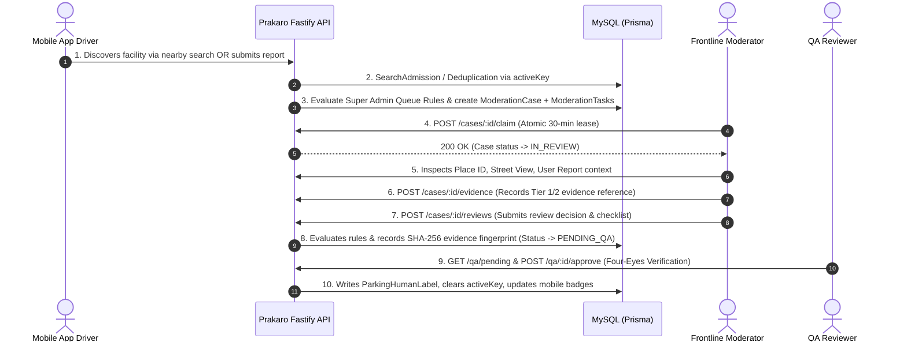

# Prakaro Case Moderation & Verification Platform
## Comprehensive Operational Guide, Workflow Architecture & Feature Reference

---

## 1. Executive Summary & Core Mandate

Prakaro is an Android-first parking discovery platform. Its core value proposition to drivers is **absolute reliability**—ensuring that when a driver is guided to a parking facility, the facility actually exists, permits vehicle entry, charges truthful rates, and adheres to published operating hours.

Sending a driver to a non-existent parking lot, a locked residential gate, or advertising free parking when fees apply damages driver trust and creates physical road congestion. To protect drivers, Prakaro enforces a **Truth-in-Advertising Mandate**:
1. **Zero Hallucination Tolerance**: Raw LLM output, synthetic estimates, or unverified Google Places text cannot mark a facility as verified.
2. **Mandatory Corroboration**: A facility can only achieve verified status after physical, operator, or authoritative municipal evidence is recorded and reviewed.
3. **Four-Eyes Quality Gate**: Reviews must be independently vetted by a second reviewer (QA) before publishing.
4. **Strict Identity Isolation**: Frontline moderators, administrative managers, and public mobile drivers are strictly separated at the database schema, session cookie, and RBAC levels.

---

## 2. High-Level System Architecture

```mermaid
flowchart TD
    subgraph INTAKE["1. Discovery & Intake Layer"]
        SearchDriver["Mobile Driver Search<br/>(Nearby Discovery)"] -->|Observe Search| IntakeEngine["Search Admission Engine<br/>(Deduplication & HMAC)"]
        ReportDriver["Mobile Driver Report<br/>(Problem Flagging)"] -->|POST /reports| ReportIntake["User Report Intake<br/>(Instant Ingestion)"]
        SuperAdmin["Super Admin Manual"] -->|Admin Route| ManualIntake["Administrative Route"]
    end

    subgraph ROUTING["2. Policy & Routing Engine"]
        IntakeEngine -->|Evaluate Rules| RoutingPolicy["Super Admin Policy Engine<br/>(Condition Tree Matching)"]
        ReportIntake -->|Evaluate Rules| RoutingPolicy
        ManualIntake -->|Evaluate Rules| RoutingPolicy
        RoutingPolicy -->|Assign Tasks| QGeneral["Queue: General Verification<br/>(source == SEARCH)"]
        RoutingPolicy -->|Assign Tasks| QReport["Queue: User Reports<br/>(source == REPORT)"]
        RoutingPolicy -->|Assign Tasks| QEscalation["Queue: Escalation<br/>(demand >= 5)"]
    end

    subgraph WORKBENCH["3. Human Moderation Workbench"]
        QGeneral & QReport & QEscalation -->|Claim Task (Lease)| Moderator["Frontline Moderator"]
        Moderator -->|Inspect Context| MapsView["Google Maps / Street View"]
        Moderator -->|Record Findings| EvidenceVault["Authorized Evidence Vault<br/>(Field Audit / Operator / Municipal)"]
        Moderator -->|Advisory Signal| AiTriage["Gemini / OpenRouter Triage<br/>(Shadow Mode Only)"]
        Moderator -->|Submit Decision| ReviewRules["Deterministic Review Engine<br/>(SHA-256 Fingerprint)"]
    end

    subgraph QA["4. Quality Assurance & Publication Gate"]
        ReviewRules -->|Status: PENDING_QA| QAReviewer["Independent QA Specialist<br/>(Must != Moderator)"]
        QAReviewer -->|REOPEN| Moderator
        QAReviewer -->|PUBLISH| Labels["Authoritative Human Label<br/>(ParkingHumanLabel)"]
        Labels -->|Live Badges| MobileApp["Prakaro Mobile App<br/>(Verified / Restricted Badges)"]
    end
```

---

## 3. End-to-End Case Lifecycle & Flow

Every parking verification case undergoes an immutable, audited 10-step lifecycle:



### Step 1: Search-Driven Intake & Problem Reporting
- **Search Observation**: When mobile drivers execute nearby parking searches, the API asynchronously evaluates the discovered facilities. If a facility has insufficient verification, it is admitted.
- **User Problem Reports**: Drivers can tap "Report Incorrect Information" directly in the Flutter app. Categories include:
  - `NOT_PARKING` (private residence, empty lot, school)
  - `PRIVATE` (gated residential, employee-only)
  - `WRONG_LOCATION` (pin misplaced on map)
  - `PRICE` (unexpected fees or extortionate tariffs)
  - `HOURS` (closed during advertised operating times)
  - `CLOSED` (permanently shut down or redeveloped)
- **Rate-Limiting & Quotas**: Search admission is throttled per actor, per day, with daily admission caps (`MODERATION_DAILY_CASE_LIMIT`).

### Step 2: Deduplication & Idempotency
To prevent queue flooding, cases enforce atomic uniqueness:
- **`activeKey`**: Formed as `facilityId:category`.
- If an active case already exists for that facility and category, incoming events increment the `demand` counter on `SearchAdmission` rather than generating duplicate cases.

### Step 3: Super Admin Queue Routing Engine
Incoming cases are evaluated by the **Super Admin Rule Engine**:
- Evaluates condition trees (`AND`, `OR`, `==`, `>=`).
- Supported fields: `source`, `category`, `demand`, `priority`, `classification`, `access`, `pricing`, `evidence`, `status`.
- **Automatic Matching**:
  - `source == SEARCH` $\rightarrow$ Assigned to **New Facility Verification Queue**.
  - `source == REPORT` $\rightarrow$ Assigned to **User Problem Reports Queue**.
  - `demand >= 5` $\rightarrow$ Fast-tracked to **High Demand Escalation Queue**.

### Step 4: Task Claiming & Concurrency Leasing
- Moderators cannot review unassigned cases.
- When a moderator clicks **Claim Task**, an atomic database transaction sets:
  - `owner = moderatorId`
  - `status = IN_REVIEW`
  - `leaseUntil = NOW() + 30 minutes`
- **Lease Protection**: Other moderators cannot claim the case while the lease is active (returns `409 Conflict`). If the moderator is inactive, the lease expires automatically, returning the case to `QUEUED`.

### Step 5: Investigation & Evidence Gathering
The moderator inspects the facility using the 3-panel **Case Workbench**:
- **Google Maps & Street View**: A one-click button opens the place pin and coordinates in Street View.
- **Place ID**: Copyable provider ID for satellite and registry verification.
- **User Feedback Banner**: For user reports, displays the driver's exact complaint and timestamps.

### Step 6: Recording Independent Evidence
Verification requires evidence recorded into `ParkingEvidenceReference`:
- **Acceptable Sources**:
  - `PRAKARO_AUDIT`: Physical field verification, photo batches, on-site entrance audits.
  - `PUBLIC_AUTHORITY`: Municipal registries, city parking authority data, transportation department gazettes.
  - `PARKING_OPERATOR`: Official garage tariff cards, commercial operator portals.
- **Validity Expiration**: Evidence entries carry an expiration date (`expiresAt`), typically 30 to 365 days.

### Step 7: Advisory AI Triage (Shadow Mode)
- The platform queries **Gemini 3.5 Flash Lite** (with OpenRouter fallback).
- AI analyses place metadata, reviews, and hours, providing an advisory outcome (`LIKELY_PARKING`, `LIKELY_NOT_PARKING`, `REQUIRES_HUMAN_INSPECTION`).
- **Policy Rule**: AI predictions are strictly advisory. AI cannot approve cases or replace physical evidence.

### Step 8: Review Submission & Fingerprinting
The moderator fills out the review form:
- Selects which recorded evidence items corroborate the decision.
- Fills in verification attributes (Facility Type, Access Permission, Pricing Tier, Operating Status).
- Enters a mandatory factual justification note.
- Selects an action:
  - `APPROVE`: Submit to QA for publication as confirmed parking.
  - `REJECT`: Submit to QA for publication as confirmed non-parking.
  - `REQUEST_MORE_EVIDENCE`: Keeps case in investigation awaiting field dispatch.
  - `ESCALATE`: Routes case to supervisors.
- **Deterministic Rule Engine Check**: If `APPROVE` is chosen but evidence indicates restricted or non-parking status, the API rejects the submission with `409 Conflict`.
- A SHA-256 cryptographic fingerprint of the evidence set is locked into the submission.

### Step 9: Independent Quality Assurance (QA) Gate
The case transitions to `PENDING_QA`:
- **Four-Eyes Principle**: The reviewer who authored the review **cannot** approve it in QA. The system returns `403/409` if self-approval is attempted.
- **Tampering Check**: The QA specialist verifies that the evidence snapshot has not mutated since submission.
- **QA Actions**:
  - `REOPEN`: Rejects the submission back to the moderator with correction notes.
  - `PUBLISH`: Grants authoritative approval.

### Step 10: Publication & Live Mobile Badging
Upon QA publication:
- An authoritative `ParkingHumanLabel` record is saved.
- The case `status` becomes `APPROVED` or `REJECTED`, and `activeKey` is set to `null`.
- The mobile API immediately reflects the decision:
  - Confirmed public parking $\rightarrow$ Displayed with **Verified** badge.
  - Non-parking / permanently closed $\rightarrow$ Filtered out or marked **Unverified / Closed**.

---

## 4. Platform Role & Permission Matrix (RBAC)

Prakaro implements strict role separation across two isolated identity tables (`super_admins` and `moderators`):

| Capability / Action | Super Admin | Moderation Admin | Supervisor / Manager | QA Reviewer | Frontline Moderator |
| :--- | :---: | :---: | :---: | :---: | :---: |
| **Create & Edit Queues** | ✅ **Exclusive** | ❌ | ❌ | ❌ | ❌ |
| **Configure Routing Rules** | ✅ **Exclusive** | ❌ | ❌ | ❌ | ❌ |
| **Manage Staff Accounts** | ✅ | ✅ | ❌ | ❌ | ❌ |
| **Assign Roles (SUPER_ADMIN)** | ✅ **Exclusive** | ❌ | ❌ | ❌ | ❌ |
| **View Audit Trail** | ✅ | ❌ | ❌ | ❌ | ❌ |
| **Configure AI Providers** | ✅ | ❌ | ❌ | ❌ | ❌ |
| **Claim Assigned Tasks** | ✅ | ✅ | ✅ | ✅ | ✅ |
| **Record Evidence** | ✅ | ✅ | ✅ | ✅ | ✅ |
| **Submit Review Decisions** | ✅ | ✅ | ✅ | ✅ | ✅ |
| **Publish in QA Gate** | ✅ | ✅ | ✅ | ✅ | ❌ |
| **View Analytics** | ✅ | ✅ | ✅ | ❌ | ❌ |

---

## 5. Case Workbench UI Architecture

The **Case Workbench** (`apps/moderation/src/pages/CaseWorkbench.tsx`) is organized into an ergonomic 3-panel operations dashboard:

```
+----------------------------------------------------------------------------------------------------+
|  <- Back to Cases  |  CASE-2026-000005  [ IN REVIEW ]  [ P0 Urgent (90) ]  |  [ Claim / Release ]  |
+----------------------------------------------------------------------------------------------------+
|  [P] Metro Station Parking Garage                                                                  |
|      104 Downtown Ave, Metro City (37.7749, -122.4194)                                             |
|      Google Place ID: ChIJN1t_tDeuEms... [Copy]       [ Open in Google Maps / Street View -> ]     |
+----------------------------------------------------------------------------------------------------+
|  [!] USER PROBLEM REPORT: NOT_PARKING                                                              |
|      "This is a private driveway with an electronic gate, definitely not public parking!"          |
|      Reported: 11/22/2026, 8:10 AM | Reporter: driver-88219                                        |
+----------------------------------------------------------------------------------------------------+
|  PANEL 1: CASE CONTEXT     |  PANEL 2: EVIDENCE VAULT        |  PANEL 3: DECISION WORKBENCH        |
|                            |                                 |                                     |
|  * Category: USER_REPORT   |  Authorized Evidence (2):       |  [Sparkles] Advisory AI (Gemini)    |
|  * Search Trigger: REPORT  |  [E1] PRAKARO_AUDIT             |  Outcome: LIKELY_NOT_PARKING        |
|  * User Demand: 4 searches |       "On-site photo confirms   |  ---------------------------------- |
|  * Created: Today          |        private gate"            |  Human Review Form:                 |
|  * Lease: 22m remaining    |  [E2] PUBLIC_AUTHORITY          |  1. Verified Status: NOT_PARKING    |
|                            |       "No permit on file"       |  2. Access: PRIVATE                 |
|  Discovered Metadata:      |                                 |  3. Pricing: UNKNOWN                |
|  * Access: Unknown         |  [ + Add New Evidence ]         |  4. Operating Status: CLOSED        |
|  * Pricing: Paid           |                                 |                                     |
|                            |  Evidence Checklist:            |  Cited Evidence: [E1, E2]           |
|  Assigned Queues:          |  [x] Cite E1 for decision       |  Justification Notes:               |
|  * User Problem Reports    |  [x] Cite E2 for decision       |  "Driveway verified via StreetView" |
|    (SLA: 24h)              |                                 |                                     |
|                            |                                 |  Action: REJECT (Submit for QA)     |
|                            |                                 |  [ Submit Decision Button ]         |
+----------------------------------------------------------------------------------------------------+
```

### Key Interactive Elements
1. **Header Inspection Strip**:
   - Displays real-time case lease clock countdown.
   - Verified Facility Name, Formatted Address, and decimal coordinates.
   - One-click copy for `Google Place ID`.
   - External button linking directly to Google Maps / Street View.
2. **User Problem Report Alert Banner**:
   - Visual amber/red banner displayed when a case is triggered by user reporting.
   - Shows user-submitted feedback notes and category.
3. **Evidence Vault (Center Panel)**:
   - Lists verified physical findings with expiration dates.
   - "+ Add Evidence" modal allowing field auditors and operators to register citations.
   - Interactive checkboxes allowing the reviewer to cite specific evidence records.
4. **Advisory AI Card (Right Panel)**:
   - Displays shadow-mode predictions from Gemini or OpenRouter.
   - Clearly disclaims that AI cannot confirm cases without evidence.
5. **Review Decision Form**:
   - Enforces answers to queue form questions or standard fallback prompts (*Confirmed Parking*, *Access*, *Pricing*, *Operating Status*).
   - Validates that decision justification is filled out.
   - Locks submission with evidence citations.

---

## 6. Super Admin Queue Routing Policy Configuration

Only `SUPER_ADMIN` accounts have access to queue creation and routing configuration (`/queues/new` and `/queues/:id/settings`).

### Rule Engine Specification
Rules are structured as recursive JSON trees evaluated by `matches(conf.rule, facts)`:

```typescript
type Rule =
  | { field: string; value: string }
  | { op: 'AND' | 'OR'; children: Rule[] };
```

### Condition Evaluator
- `demand` and `priority`: Evaluated with numerical greater-than-or-equal (`>=`).
- All other fields (`source`, `category`, `classification`, `access`, `pricing`, `status`): Evaluated with strict equality (`===`).

### Standard Queue Configurations

#### 1. General Verification Queue (`QUEUE-GENERAL-001`)
- **Name**: New Facility Verification
- **Priority**: 50 | **Capacity**: 1000 | **SLA**: 48 Hours
- **Routing Rule**:
  ```json
  { "field": "source", "value": "SEARCH" }
  ```
- **Review Questions**: Facility Existence, Access Tier, Pricing Tier.

#### 2. User Problem Reports Queue (`QUEUE-REPORT-001`)
- **Name**: User Problem Reports
- **Priority**: 90 | **Capacity**: 500 | **SLA**: 24 Hours
- **Routing Rule**:
  ```json
  { "field": "source", "value": "REPORT" }
  ```
- **Review Questions**: Report Validity (`SUBSTANTIATED` / `UNSUBSTANTIATED`), Corrective Action Taken.

#### 3. High Demand Escalation Queue (`QUEUE-ESCALATION-001`)
- **Name**: High Demand Facilities
- **Priority**: 80 | **Capacity**: 200 | **SLA**: 12 Hours
- **Routing Rule**:
  ```json
  { "field": "demand", "value": "5" }
  ```
- **Review Questions**: Rapid Verification Decision, Field Audit Requirement.

---

## 7. Quality Assurance (QA) & Governance Rules

The QA gate (`/qa`) protects against human error, fraud, or rogue moderators:

1. **Anti-Self-Approval Enforcement**:
   ```typescript
   if (latestReview.reviewerId === currentActor.userId) {
     throw new ForbiddenError('Four-eyes policy violation: Reviewer cannot QA approve their own submission.');
   }
   ```
2. **Evidence Integrity Fingerprint**:
   During submission, the system calculates:
   $$\text{Fingerprint} = \text{SHA256}(\text{evidenceId}_1 + \text{finding}_1 + \text{expiresAt}_1 + \dots)$$
   When the QA reviewer clicks **Publish**, the engine verifies that the fingerprint is identical. If evidence was revoked, altered, or expired while in the QA queue, publication is aborted.
3. **Reopening Workflows**:
   If the QA reviewer determines that the justification is inadequate or evidence insufficient, they click **Reopen**. The case transitions to `REOPENED`, the previous claim is cleared, and it returns to the queue with QA feedback notes.

---

## 8. Immutable Audit Trail & Compliance

Every state transition produces an append-only audit record in `ModerationAudit`:
- **`actor` / `actorId`**: ID of the moderator, admin, or user.
- **`actorType`**: `SUPER_ADMIN`, `MODERATOR`, `USER`, or `SYSTEM`.
- **`actorSnapshot`**: Name, email, and role at the instant the action took place.
- **`action`**: `CASE_CLAIMED`, `CASE_RELEASED`, `CASE_ROUTED`, `REVIEW_SUBMITTED`, `QA_APPROVED`, `QA_REOPENED`, `QUEUE_CREATED`, `QUEUE_UPDATED`.
- **`target`**: ID of the affected case or queue.
- **`before` / `after`**: JSON diff of modified attributes.

---

## 9. Default Seeded Credentials Reference

For testing and local development, the platform provides fresh standardized accounts:

| Portal | Role | Email | Password |
| :--- | :--- | :--- | :--- |
| Moderation Console | **Super Admin** | `admin@prakaro.app` | `Admin123!` |
| Moderation Console | **Moderation Admin** | `modadmin@prakaro.app` | `ModAdmin123!` |
| Moderation Console | **Frontline Moderator** | `moderator@prakaro.app` | `Moderator123!` |
| Moderation Console | **QA Reviewer** | `qa@prakaro.app` | `QAReviewer123!` |
| Mobile Application | **Mobile Driver** | *(Register via app)* | *(User-chosen)* |

---

## 10. Summary of Key Files

| Module | Location | Description |
| :--- | :--- | :--- |
| **API Routes** | `apps/api/src/modules/moderation/routes.ts` | All Fastify endpoints for cases, queues, reviews, reports, and QA. |
| **Intake Engine** | `apps/api/src/modules/moderation/intake.ts` | Search observation, admission deduplication, and case routing. |
| **Configuration** | `apps/api/src/modules/moderation/config.ts` | Zod schemas for queue rules, question forms, and answer validators. |
| **Workbench UI** | `apps/moderation/src/pages/CaseWorkbench.tsx` | 3-panel moderator investigation, Street View, and review form. |
| **Queues UI** | `apps/moderation/src/pages/Queues.tsx` | Queue table, capacity meters, and Super Admin creation links. |
| **Queue Settings**| `apps/moderation/src/pages/QueueSettings.tsx`| Super Admin visual rule editor and question builder. |
| **Clean Reset** | `apps/api/scripts/clean-and-reset-db.ts` | Database cleanup script and clean seed generator. |
