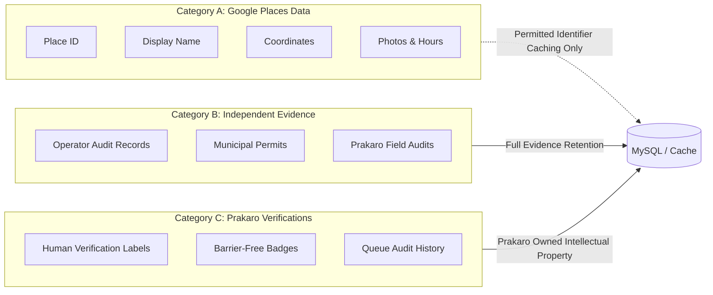

# Prakaro — Google Maps Platform & Places API Compliance Audit
**Document Version:** 1.0.0 (Milestone 13.1 Compliance Verification)  
**Applicability:** Full Monorepo (`apps/mobile`, `apps/api`, `apps/moderation`)  
**Standard Reviewed:** Google Maps Platform Terms of Service & Service-Specific Terms (Section 3.2.3 — Places API)  

---

## 1. Compliance Audit Objective

As an enterprise mobility product, Prakaro interfaces directly with Google Places API (New) for location discovery, photos, and address geocoding. This audit verifies strict adherence to Google Maps Platform terms regarding data caching, attribution, prohibited storage, and third-party transmission.

---

## 2. Data Categorization & Inventory

Prakaro maintains strict boundary separation between three distinct data categories:

### Data Category Breakdown

| Data Field | Source | Permitted Storage | Retention Policy | Third-Party LLM Sharing |
| :--- | :--- | :--- | :--- | :---: |
| **`googlePlaceId`** | Google Places | **Permitted** (Explicitly allowed for caching & reference) | Indefinite (as reference key) | Allowed (as opaque ID) |
| **Place Name & Address** | Google Places | **Ephemeral Only** (Client display / memory cache) | 24 Hours Max | **PROHIBITED** |
| **Coordinates (Lat/Lng)** | Google Places | **Ephemeral Only** (Client display / map view) | 24 Hours Max | **PROHIBITED** |
| **Photos & Imagery** | Google Places | **Zero Disk Storage** (Proxied via Fastify memory buffer) | 0 Seconds (Streaming memory cache) | **PROHIBITED** |
| **Reviews & Ratings** | Google Places | **Zero Disk Storage** (Never persisted to MySQL) | 0 Seconds | **PROHIBITED** |
| **Independent Evidence** | Prakaro Operator Audit | **Full Storage** (Prakaro-owned or verified) | 90–365 Days (with expiration) | Permitted (Synthetic facts only) |
| **Human QA Decisions** | Prakaro Trust & Safety | **Full Storage** (Prakaro intellectual property) | Permanent / Audit Record | Permitted |

---

## 3. Storage & Caching Protections

1. **Zero Google Places Content Persistence**:
   - The MySQL database stores **only the opaque Place ID** (`googlePlaceId`), never raw Google Places response JSON, reviews, ratings, or photo binary data.
   - The `parking_evidence_reference` table is restricted to independent, verified sources (`PRAKARO_AUDIT`, `PARKING_OPERATOR`, `PUBLIC_AUTHORITY`). Google Places is explicitly rejected as an independent evidence source.
2. **In-Memory Photo Proxying**:
   - Google Places photo media is fetched on demand via Fastify proxy (`GET /api/v1/parking/:id/photos/:photoIndex/media`).
   - Photos are never written to disk, Cloud Storage, or database blobs. Responses are streamed directly with `Cache-Control: private, max-age=86400`.
   - Size limit protection (10MB max) and content-type validation (`image/jpeg`, `image/png`, `image/webp`) prevent abuse.

---

## 4. LLM Data Isolation: Zero Places Content Transmission

Google Maps Platform policies strictly forbid utilizing Google Places content to train, fine-tune, or prompt third-party artificial intelligence models:
- **Enforcement**: When dispatching advisory triage requests to Google Gemini or OpenRouter, Fastify transmits **only independent evidence findings** (e.g., operator permit IDs, physical barrier audit reports).
- **Prohibition**: Google Places user reviews, place ratings, and descriptions are **never passed in AI prompts**.

---

## 5. UI Attribution Standards

1. **Flutter Mobile Application**:
   - Every list view and details bottom sheet displays the required compliant footer: `GoogleAttributionFooter` (`apps/mobile/lib/features/parking/presentation/widgets/google_attribution.dart`).
   - Renders the official "Powered by Google" badge adhering to contrast and clear-space guidelines.
2. **React Operations Console**:
   - Explicitly displays data source attributions on all facility cards.
   - Displays clear distinctions between Google Places discovery metadata and verified Prakaro audit records.
