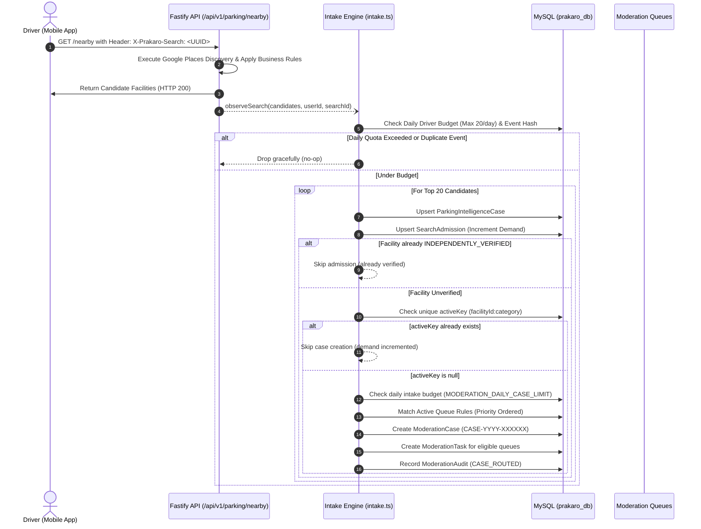

# Search-Driven Intake & Admission Policy

## 1. Principles of Search-Driven Admission

To prevent uncontrolled API costs, database bloat, and operational fatigue, Prakaro does not perform blind geographic scraping, polygon grid crawling, or bulk city harvesting. 

**Every moderation candidate must originate from a genuine driver-initiated search in Prakaro.**

---

## 2. Cryptographic Privacy & Anti-Spam Protections

To protect driver privacy while strictly preventing malicious intake flooding:
- Driver identities are digested using HMAC-SHA256 salted by `BETTER_AUTH_SECRET`:
  `actor = HMAC_SHA256(UTC_DAY + ":" + userId)`
- Event hashes ensure idempotency:
  `event = HMAC_SHA256(actor + ":" + searchEventId)`
- Per-facility deduplication hashes prevent a single user from inflating demand for the same place repeatedly in a 48-hour window:
  `uniqueFacility = HMAC_SHA256(actor + ":facility:" + googlePlaceId)`

---

## 3. Case Code Formatting

All moderation cases are assigned atomic, human-readable identifier codes generated sequentially via `ModerationCounter`:
- Format: `CASE-<YYYY>-<000000>`
- Examples: `CASE-2026-000001`, `CASE-2026-000142`
- Guarantees: Monotonically increasing, collision-free, suitable for search and customer service tickets.

---

## 4. Operational Budget Limits

Intake volume is strictly governed by environment controls:

| Setting | Default | Purpose |
| :--- | :--- | :--- |
| `MODERATION_INTAKE_ENABLED` | `true` | Master switch for search ingestion |
| `MODERATION_DAILY_CASE_LIMIT` | `50` | Maximum new cases routed per UTC day |
| Max Cases Per Driver Search | `2` | Max new cases created from a single search event |
| Max Search Events Per Driver | `20` | Max search admissions credited per driver per day |
